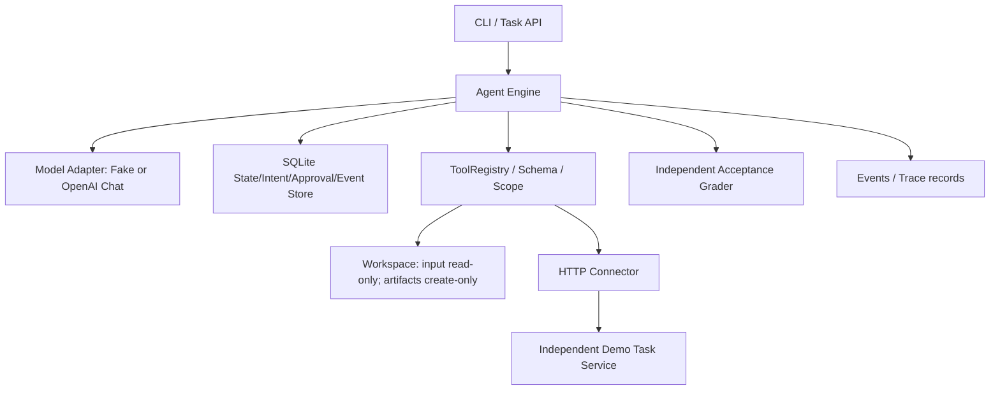

# 贯穿式工程架构设计：Agent Workbench

## 1. 设计目标

用户把项目资料放入受控工作区，Agent 在本机合成示例环境中读取 Markdown、统计 CSV、访问独立任务服务、生成报告，可按授权创建外部事项。系统必须区分 `Model Decision`、`Tool Execution`、`Business Acceptance`，同时记录可恢复的执行事实。

## 2. 组件图



ModelAdapter 负责协议，不负责批准；ToolRegistry 不负责“任务完成”的裁决；StateStore 管理可信进度，模型历史只是状态的一部分；Grader 不使用模型文本当成唯一完成依据。

## 3. 正常执行时序

```mermaid
sequenceDiagram
 participant User
 participant Engine
 participant DB
 participant Model
 participant Tool
 participant Remote
 User->>Engine: run(task_id,run_id)
 Engine->>DB: create run + snapshot(input)
 Engine->>Model: messages + tool schemas
 Model-->>Engine: tool call(id,name,args)
 Engine->>DB: persist assistant + ToolIntent
 Engine->>Tool: validate schema/scope; call
 Tool->>Remote: fetch tasks (read-only)
 Remote-->>Tool: JSON
 Tool-->>Engine: tool result
 Engine->>DB: mark result done + checkpoint
 Engine->>Model: tool_result(call_id)
 Model-->>Engine: report draft / final
 Engine->>Tool: write artifact
 Engine->>DB: record result + checkpoint
 Engine->>Engine: verify artifact + unchanged inputs
 Engine-->>User: completed + artifact reference
```

## 4. 崩溃与不确定副作用的具体窗口

1. **工具意图前**崩溃：可重新请求模型决策。
2. **意图已落库但工具未调用**：恢复时读取稳定 ToolIntent，不生成新的操作 ID。
3. **工具写成功但结果未记录**：本地文件仅在内容完全一致时复用；外部写操作先根据稳定 `run_id:call_id` 查询远端，确认后恢复。
4. **远端无法确认**：进入 `needs_review`，不自动假设失败、不换新 ID 重试。
5. **结果已保存但模型未看到**：Run 重读 ToolIntent Result，补全 Tool Message，不重新执行副作用。

当前 SQLite 运行时是单 Worker 模式；未实现跨进程执行所有权，两个进程同时执行同一 Run 仍可能造成状态争用。这个限制必须进入生产化改造计划。

## 5. 审批语义

`create_followup` 的调用先记 Intent，然后进入 `waiting`。用户通过 CLI 查看具体 Tool Name/Arguments 后执行 approve，Store 对比原 Intent 指纹并将授权写入 Intent。即使审批已使用且程序刚好崩溃，仍可根据持久化的 authorized 标志恢复该**同一操作**，而不是重新使用批准执行其他动作。

演示 CLI 只是信任使用者手动执行命令，并未验证 Approver 的真实身份或做过期/撤销；不能直接将此示例部署给多个真实用户。

## 6. 数据契约

- `runs`：Task/Run 身份、执行状态、模型消息、轮次、输入快照、最终答复。
- `intents`：调用 ID、工具名、参数指纹、状态、是否已授权、结果。
- `approvals`：Run+Call ID 对应的待/已消费批准。
- `events`：操作事件及可追踪序号，默认不记录文件正文。
- `artifacts`：报告文件，保存运行目录的受控输出。
- `external_service.followups`：独立远端服务的稳定 idempotency_key。

## 7. API 适配器边界

真实模型遵循 OpenAI-compatible Chat Completions `tools`、`assistant.tool_calls` 与 `tool.tool_call_id` 协议；不同供应商的 JSON Schema/工具能力可能不同。ModelAdapter 不能直接访问系统凭证与文件。

课程初期用 FakeModel 做固定行为测试，再引入真实模型并单独进行在线 E2E。不能拿 FakeModel 的 100% 通过率当作真正的 Agent 智能性能。

## 8. 生产化差距

**当前可验证**：离线协议闭环、单进程 Run 的恢复、固定业务幂等、外部 HTTP 数据读取、人工批准演示、测试和事件。

**未达到**：真正的 OS Sandbox；可信多用户审批；多 Worker 任务租约；OS 级进程杀死/重启覆盖；模型 Context 长窗口压力；持久长期 Memory；正式 MCP Server；云服务接入；OTel 和成本计费；生产负载容量/SLA。

这些不应该在教材里被隐藏或夸大。高级工程能力来自知道这些边界并能为部署风险给出证据。
